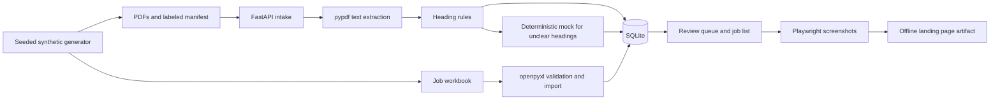

# Handwerk Beleg-Assistent

A local Python 3.12 prototype for sorting incoming PDFs and tracking jobs for a small trade business. **All data is synthetic and generated by a seeded script.** The sample includes 152 fictional PDFs, a labeled benchmark subset of 72 PDFs, and an Excel workbook with 24 fictional jobs.

## Architecture



## Run on Linux

The Actions workflow runs all jobs automatically on Linux with Python 3.12. It installs dependencies from public registries and runs both the API and browser against localhost. No service accounts, API keys or containers are needed.

To reproduce from the repository root:

```bash
python -m pip install '.[dev]'
beleg-assistent generate --seed 2829 --out artifacts/sample
beleg-assistent --db artifacts/demo.sqlite load-demo artifacts/sample
beleg-assistent evaluate artifacts/sample --out artifacts/evidence
HANDWERK_DB=artifacts/demo.sqlite python -m uvicorn handwerk.api:app --host 127.0.0.1 --port 8765
```

Open `http://127.0.0.1:8765/` for the review queue, `/auftraege` for the job list, or `/docs` for the API interface. The CLI and service use `handwerk.sqlite` by default. Use `--db` for the CLI and `HANDWERK_DB` for the service to point both at the same file.

| Method and path | Operation |
| --- | --- |
| `POST /documents` | Upload a multipart PDF in the `file` field. The same bytes return the existing record. |
| `GET /documents`, `GET /documents/{id}` | List or inspect types, review status and job links. Filter the list with `?status=pruefen`. |
| `GET /documents/{id}/file` | Download the stored original. |
| `PATCH /documents/{id}/job` | Set `{"job_id":"AUF-1001"}` or clear the link with a null value. |
| `PATCH /documents/{id}/review` | Set the reviewed type, for example `{"document_type":"rechnung"}`. |
| `GET /jobs`, `PATCH /jobs/{job_id}/status` | List jobs or set a status, for example `{"status":"in_arbeit"}`. |

For a workbook on its own, run `beleg-assistent --db artifacts/demo.sqlite import-jobs workbook.xlsx`. The `Auftraege` sheet uses `auftragsnr,kunde,status,betrag_eur` as its headers. Valid statuses are `offen`, `in_arbeit`, `abgeschlossen` and `storniert`. Amounts are numeric EUR values with at most two decimal places. The importer commits valid rows, reports rejected row numbers in JSON, and returns exit code 2 when there are row errors. Reimporting refreshes customer and amount while retaining the status and document links in the app.

## Classification and evaluation

The pipeline first checks for an exact type heading. The pluggable interface receives extracted text when that rule is inconclusive. The default provider is a deterministic phrase-matching mock. A separate rule fallback handles provider unavailability, timeouts and invalid results. Scores below 0.80 and unknown types go to review. Review keeps the original prediction available alongside the corrected type.

The benchmark runs against actual ReportLab PDFs with neutral filenames. It measures exact type match before review and counts all labeled cases, including those flagged for review. The scenario set includes standard headings, aliases, conflicting clues, misleading headings and sparse text.

## Demo and verification

The `landing-page` Actions artifact contains `index.html`, CSS and two screenshots from the running demo. Open the extracted HTML file offline. Playwright also checks document linking, status changes, manual review and the mobile landing layout.

The `synthetic-data-and-benchmark` artifact contains the generated PDFs, workbook, manifest, benchmark report and test evidence. The project decisions are in the [German build log](docs/build-log.md). [GitHub Actions workflow](https://github.com/hamza2829/handwerk-beleg-assistent/actions/workflows/ci.yml)

## Limits

All records represent fictional jobs and customers. The provider is a mock, and its confidence values are heuristic. The benchmark measures the generated scenario mix only. Text extraction requires a PDF text layer, and image-only scans need manual review. The prototype is intended for a local demo, with authentication, production hardening and deployment outside its scope.
